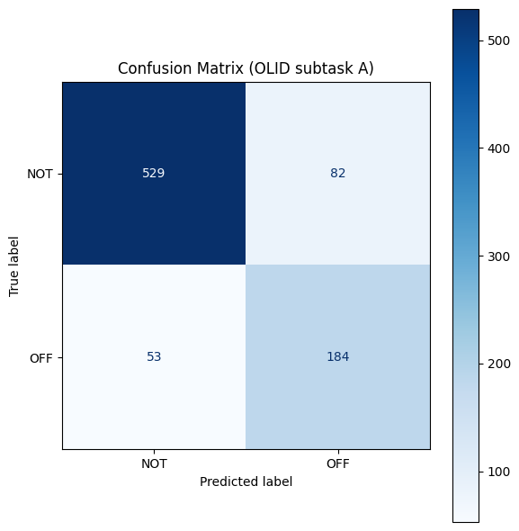
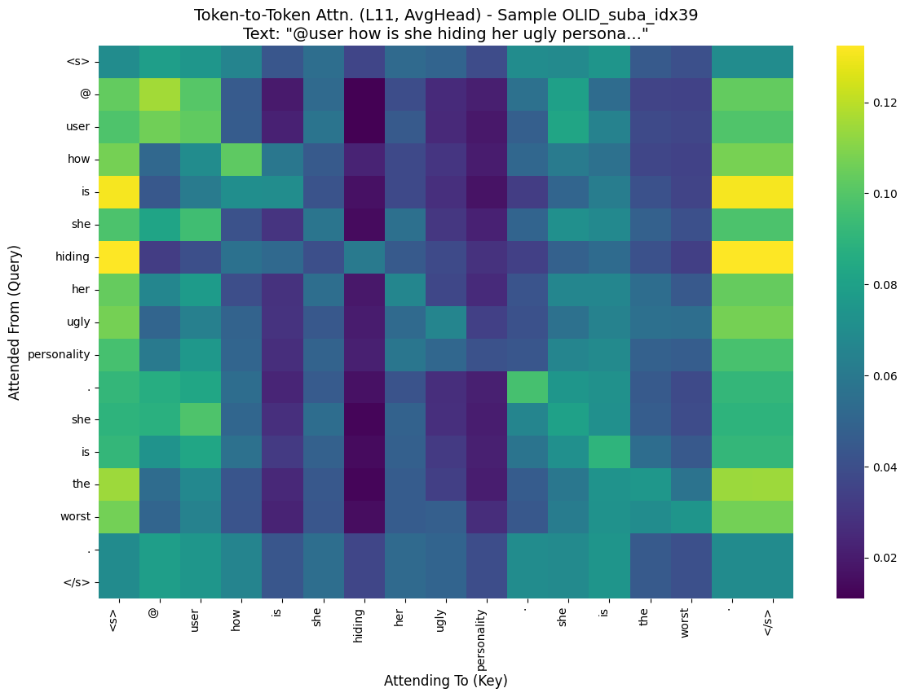
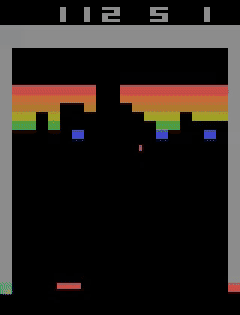

# Advanced Deep Learning: RoBERTa Hate-Speech Detection, GANs, Image Captioning and DQN

Group work from *Advanced Deep Learning* (D7047E), Luleå University of Technology, 2025. The main
project fine-tunes **RoBERTa** for hate-speech and offensive-language detection, adds **FGM
adversarial training**, and explains predictions with **attention visualisation**. The labs cover
transformers vs. MLPs, **GANs, diffusion and adversarial examples**, **image captioning**, and a
**DQN agent playing Atari Breakout**.

**Stack:** PyTorch · Hugging Face Transformers · scikit-learn · OpenAI Gym (Atari) · Stable-Baselines3 · Jupyter

## Main project: RoBERTa hate-speech detection

📄 [Paper (PDF)](project-hate-speech-detection/paper_roberta_hate_speech_fgm_attention.pdf) ·
[Slides](project-hate-speech-detection/presentation.pptx) ·
[Notebook](project-hate-speech-detection/ProjectNLP_Hate_Speech_Detection_Group_5.ipynb)

- **Model:** `cardiffnlp/twitter-roberta-base`, fine-tuned with AdamW, warm-up and early stopping
- **Robustness:** Fast Gradient Method (FGM, ε = 0.1) adversarial training on the embeddings
- **Explainability:** [CLS]-to-token and token-to-token attention maps from the last layer
- **Data:** HASOC 2019 (subtasks 1–3) and OLID 2019 (subtasks a–c), with class-weighted loss
  for imbalanced labels
- **Baseline:** TF-IDF + feed-forward ANN

| Task | RoBERTa accuracy | RoBERTa F1 (weighted) | ANN baseline F1 |
|---|---:|---:|---:|
| OLID a: offensive vs. not | **0.849** | **0.851** | 0.756 |
| HASOC 1: hate/offensive vs. not | **0.807** | **0.815** | 0.565 |
| OLID b: targeted vs. untargeted | 0.756 | 0.799 | 0.839 |
| OLID c: individual / group / other | 0.673 | 0.675 | 0.579 |
| HASOC 2: hate / offensive / profane | 0.625 | 0.594 | 0.490 |

RoBERTa is clearly stronger on the main binary tasks. On the small, heavily imbalanced
targeted/untargeted subtasks (OLID b, and HASOC 3 where RoBERTa reaches only F1 0.36 against the
baseline's 0.80) the simple baseline does better, a known weakness of fine-tuning large models on
very few minority-class examples.

| Confusion matrix (OLID a) | Attention map (layer 11, averaged heads) |
|---|---|
|  |  |

## Labs

| Folder | Topic | What we built |
|---|---|---|
| [`lab1-ann-vs-transformer/`](lab1-ann-vs-transformer) | Text classification | Sentiment classification of Amazon reviews with an MLP and a small transformer, trained and compared side by side |
| [`lab2-gan-diffusion-adversarial/`](lab2-gan-diffusion-adversarial) | Generative models | Conditional GAN for MNIST digits, a diffusion model on MNIST, and adversarial images that turn a classifier's "4" into a "9" |
| [`lab3-image-captioning/`](lab3-image-captioning) | Vision + language | Pretrained ResNet image encoder with an LSTM caption decoder on Flickr8k, evaluated with BLEU |
| [`lab4-dqn-atari-breakout/`](lab4-dqn-atari-breakout) | Deep RL | DQN with replay buffer, target network and ε-greedy exploration on `BreakoutNoFrameskip-v4`; trained model and gameplay videos included |

**DQN agent after training** (episode 9000, sped up 2×; score above 300):

## Data

Datasets are not included. HASOC 2019 and OLID 2019 are available from their shared-task
organisers, MNIST downloads automatically through `torchvision`, and Flickr8k is public.

## Team

Group 5: **Abdalrahman Nasser**, Bardia Baigy, Deborah Aittokallio, Dominic Addo and William Poromaa.
Published with the team's permission from the original repository
[williamporomaa/D7047E_exercise_group_5](https://github.com/williamporomaa/D7047E_exercise_group_5).
